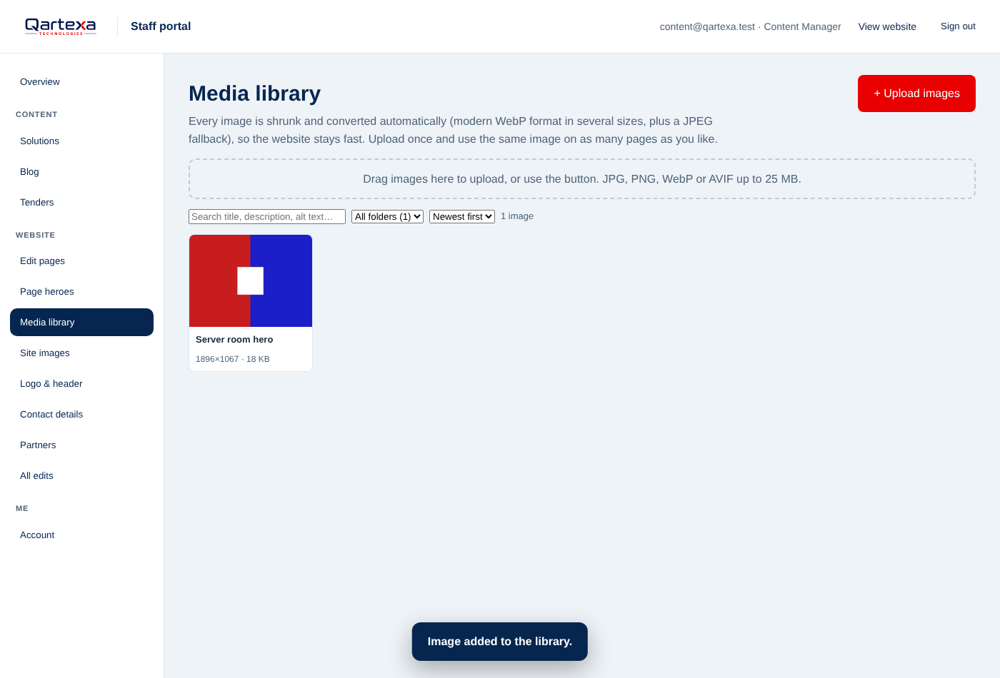
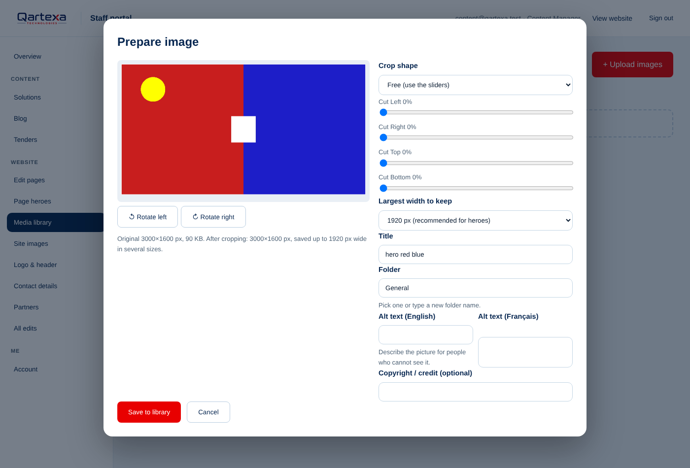
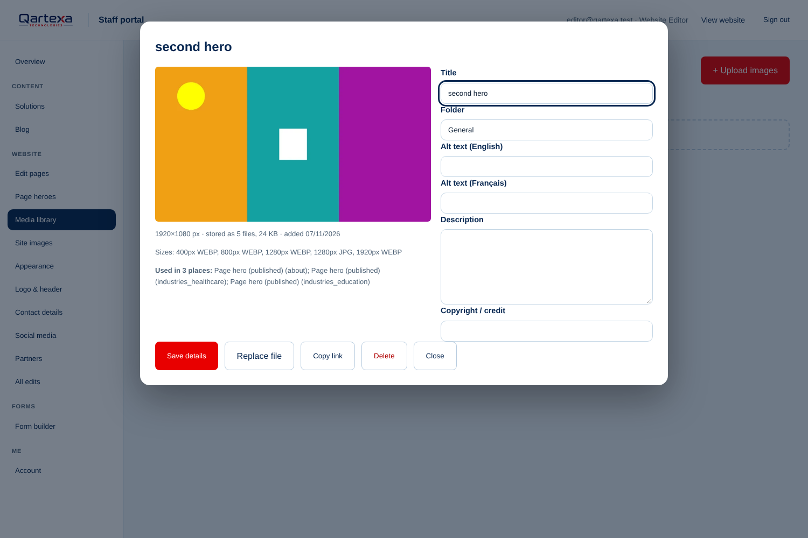
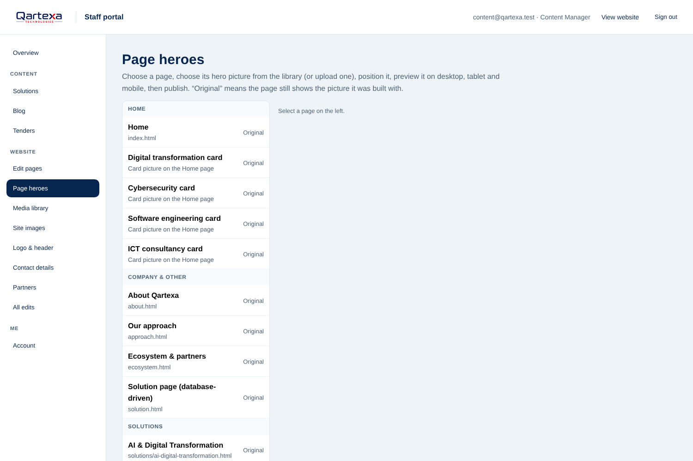
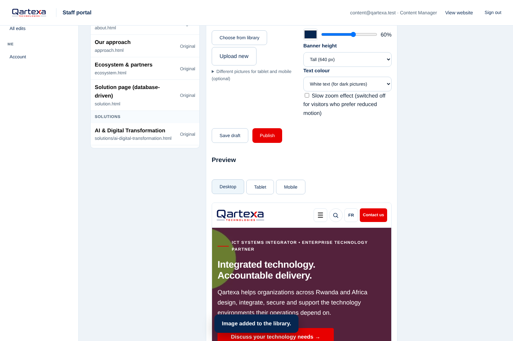
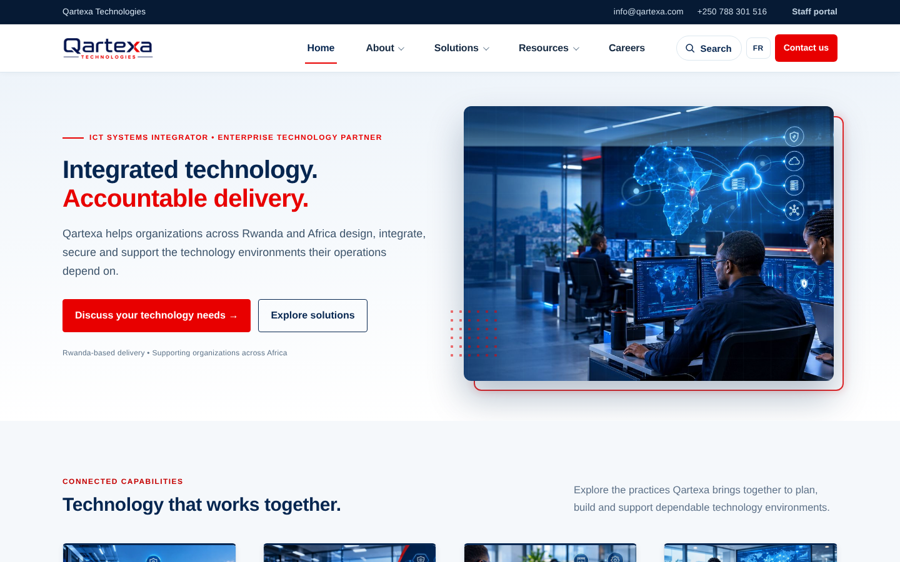
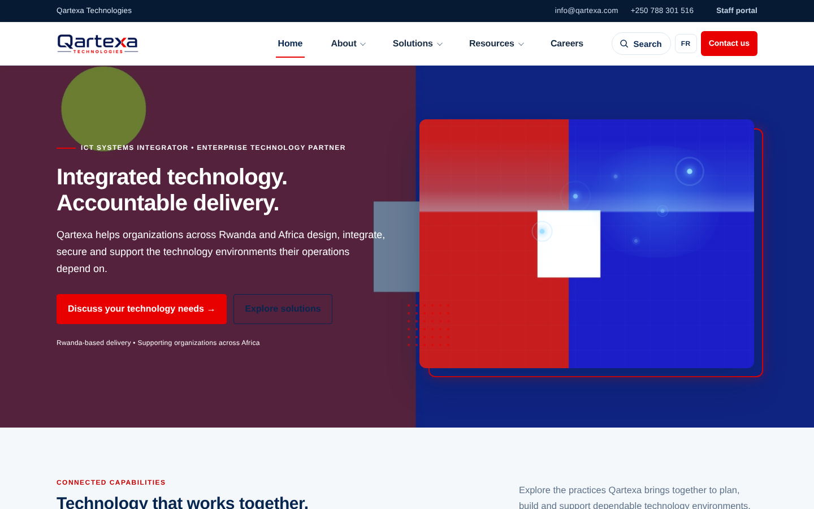
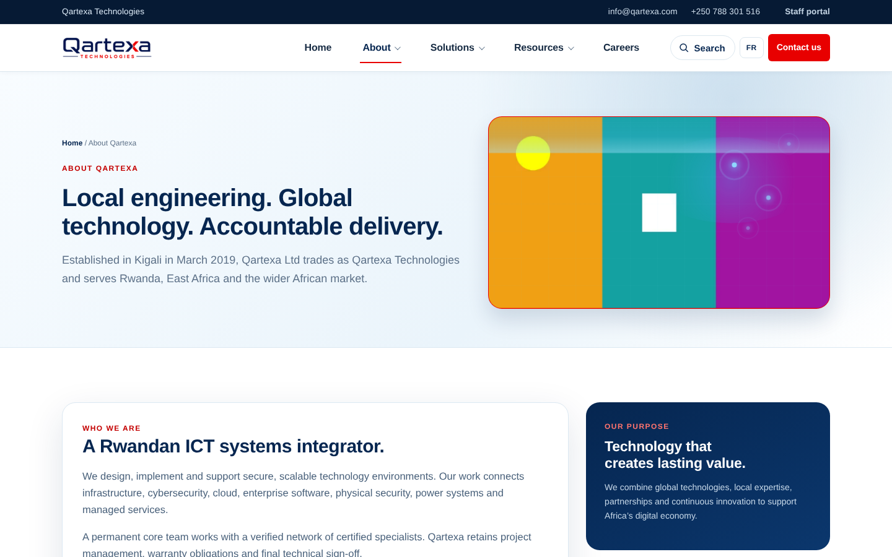
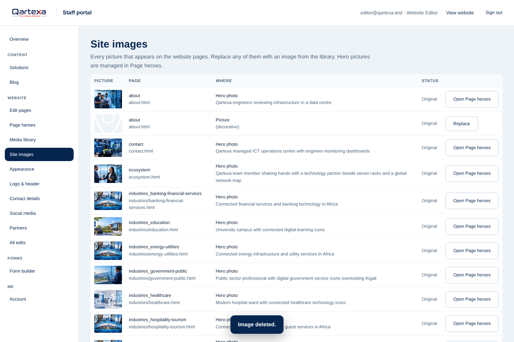

# Staff portal: everyday guide

Sign in at **portal.html** (there is a "Staff portal" link at the top right of every page). Everything you save appears on the public website straight away (visitors who already opened the site in the last two minutes may need to refresh).

## Solutions
- **New solution:** fill in the title (English required, French optional), a short tagline (shown in the menu), a one-or-two-sentence summary, the full description, and capabilities (one per line). Choose where it appears in the menu/footer and which overview group it belongs to, add an image, and set **Visibility** to *Published*.
- **Hide or restore:** the 11 original solutions have their own page files. Choose **Hide** to remove one from menus, cards and its page; edit it and set Visibility to *Published* to bring it back. Their page text itself is changed in the website files, not here.
- **Delete:** only solutions you created can be deleted. Hide first if you may need it again.
- **Order:** smaller numbers appear first within their group.

## Jobs and Applications
- Set a job to **Open** to show it on Careers. It disappears automatically after its closing date; set it to **Closed** or **Draft** to remove it earlier.
- New applications show a red number next to **Applications**. Open one to read the message, download the CV, set a status (New, Reviewing, Shortlisted, Rejected, Hired) and add private notes. **Export CSV** gives a spreadsheet.
- Delete applications you no longer need, in line with the Privacy Policy.

## Blog
Write the article in English and (optionally) French. If the French box is empty, visitors see English. Set a future **Publish date** to keep it hidden until then. Add a cover image (JPG, 1400 px wide or less, under 5 MB).

## Tenders
Add the reference, title, description, closing date, and upload the tender document (PDF). Status **Open** shows a "days left" counter; switch to **Closed** or **Awarded** afterwards. Tenders stay listed as a public record unless you set them to Draft.

## Formatting text
In description boxes you can use: `## Heading`, `**bold**`, `*italic*`, `- bullet`, `1. numbered`, `[link text](https://…)`, `> quote`. Leave a blank line between paragraphs. Raw HTML is not allowed (for safety).

## Good habits
- Keep photos under 5 MB; use JPG at about 1400 px wide.
- Always check the **FR** version of important pages after publishing.
- Sign out on shared computers.

## Editing the website itself (Studio)
1. Sign in at **portal.html**. A dark bar appears at the bottom left of every page: **Edit page**, **Pictures**, **Settings**, **Dashboard**. (Or open **Edit pages** in the dashboard and choose a page.)
2. Click **Edit page**. Hover anything: a red dotted line shows what you can change. **Click it.**
3. **Text** (headings, paragraphs, buttons, menu and footer links): type the English and the French version, then **Save**. It is live immediately. **Reset to original** brings the old wording back.
4. **Links and buttons:** open "This is also a link" to change where it goes or to hide it. Use **+ Add another link after this one** to add a menu or footer link.
5. **Pictures** (hero image, solution images): click the picture, or use **Pictures** for a list. Upload a new one, drag **Zoom** and **Focus** to crop it nicely, add a description, **Save**.
6. **Header and footer** edits apply to every page. **Logo size and file**: dashboard, *Logo & header*. **Email, phone, social links**: *Contact & social*.
7. **Partners:** dashboard, *Partners*: add, hide, reorder or replace partner logos.
8. **All edits** lists everything you changed; revert any of them.

Edits are stored separately from the page files, so you can always go back to the original. Visitors who opened the site in the last two minutes may need to refresh to see a change.

---
# V4 additions (read this first)
Sign in at `portal.html`. What you see depends on your role (shown next to your e-mail at the top).

**Appearance**: pick colours/fonts/shapes on the left; the website preview on the right updates instantly. Use Desktop/Tablet/Mobile buttons and the page picker. **Nothing is public until you press Publish.** *Save draft* keeps work for later; *Cancel changes* returns to the last saved state; *Restore Qartexa default* loads the original look (then Publish). If a warning says "contrast", choose a darker/lighter pair so text stays readable.

**Social media**: *Add account*, pick the platform (the icon and name fill in), paste the full link (starts with https://), tick where it shows (header, footer, contact page). Use ↑↓ to reorder, Hide/Show, Edit, Delete. Custom icon: paste or upload an SVG; anything unsafe in it is removed automatically.

**Form builder**: open a form → *Settings & email* to set the wording and who receives messages (one address per line; change whenever you like), then *Fields* to add, edit, reorder or hide fields. For choices write `English | Français` on each line. Any form is also available on its own page: `form.html?f=your-form-name`. If *nobody yet* shows in the list, messages are stored but no e-mail is sent.

**Form submissions**: click a message to read it, set its status, add private notes, archive or delete it. *Export CSV* downloads what is currently filtered.

**Jobs and tenders**: type the closing **date and time** (Kigali time). At that moment the item leaves the public site and applications stop. To extend or reopen, set a new future time and save. Tenders: tick *Show in Past tenders* if you want a closed tender to stay visible as history; tick *Archived* to hide it everywhere on the public site.

**Blog**: choose *Scheduled* (or *Published* with a future date and time). It appears by itself when the time arrives.

**Staff & roles** (Super Administrator only): invite people, change roles, deactivate or remove. **Activity log**: see who changed what; *Details* → *Restore the earlier version*. **Account**: change your e-mail (confirm via the link sent) or password.

---
# V5 additions: pictures and hero images (with screenshots)

## Media library
Open **Media library** in the left menu. Drag pictures onto the dotted box, or press **+ Upload images**.

One picture: a **Prepare image** window opens. Choose the crop shape, zoom, move the crop by dragging, rotate, choose the largest width, type a title, folder and a short description (alt text, in English and French). Press **Save to library**. Several pictures: they are optimised automatically and you see before/after sizes.

Click any picture to see its size, where it is used, to edit its details, **Replace file** (keeps every page that uses it up to date, and keeps the old file so you can restore it), copy its link, or delete it (only when it is not used anywhere).

## Page heroes
Open **Page heroes**. Pages are grouped (Home, Company, Solutions, Industries…). “Original” means the page still shows the picture it was built with.

Select a page, choose or upload a picture, click the picture to set the point that must stay visible, set the overlay, height and text colour (full-width banner pages), and check the preview. **Save draft** keeps it private; **Publish** makes it public. **Restore previous image** and **Back to original** undo it.

Result on the public homepage (test photograph used for the test only):

| Before | After publishing | On a phone |
|---|---|---|
|  |  |  |

Pages that already show a photograph beside the heading (About, Solutions, Industries…) simply get the new photograph in the same place:

## Site images
**Site images** lists every other picture on the pages. Press **Replace**, choose from the library, done. **Restore original** undoes it.

*The pictures in these screenshots are plain test images created for testing; replace them with Qartexa's real photography.*
